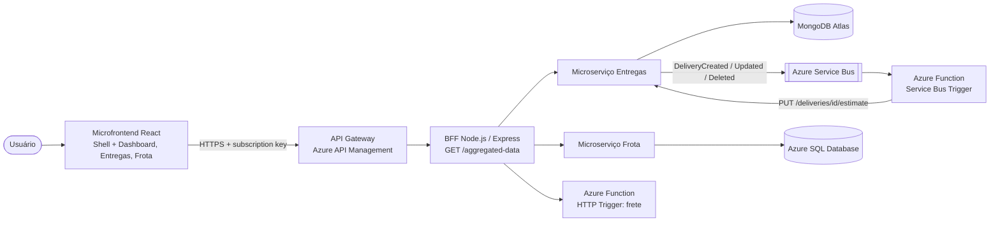

# CloudLog · Microserviço de Frota (Azure SQL Database)

Projeto PJBL da disciplina **Arquitetura de Software e Soluções Cloud** (PUCPR) - Prof. Manoel Valerio da Silveira Neto.

## Alunos

- Camilla Augusta Uber
- João Davi
- Laura Guillarducci

## Sobre

Microserviço 2. Responsável pelo domínio **Frota**: veículos e motoristas, com CRUD completo e regras de negócio. Banco exclusivo: **Azure SQL Database** (Database per Service). As tabelas são criadas na primeira conexão (`sql/schema.sql`).

## Arquitetura da solução



| Projeto | Repositório |
|---|---|
| Microfrontend (React) | [cloudlog-frontend](https://github.com/laducci/cloudlog-frontend) |
| BFF (Node.js/Express) | [cloudlog-bff](https://github.com/laducci/cloudlog-bff) |
| Microserviço de Entregas (MongoDB) | [cloudlog-entregas-service](https://github.com/laducci/cloudlog-entregas-service) |
| Microserviço de Frota (Azure SQL) | [cloudlog-frota-service](https://github.com/laducci/cloudlog-frota-service) |
| Azure Function (frete + eventos) | [cloudlog-function](https://github.com/laducci/cloudlog-function) |

### Clean Architecture + Vertical Slice

```
src/
├── Domain/          entidades, regras de negócio, erros e portas (interfaces) - sem dependências externas
├── Application/
│   └── Features/    uma pasta por caso de uso (Vertical Slice)
│       ├── CreateVehicle/ GetVehicle/ ListVehicles/ UpdateVehicle/ DeleteVehicle/
│       └── CreateDriver/  GetDriver/  ListDrivers/  UpdateDriver/  DeleteDriver/
├── Infrastructure/  adaptadores concretos (banco, mensageria, HTTP) que implementam as portas do Domain
└── API/             camada de entrada (Express/Functions), Swagger e Composition Root
```

Regra de dependência (verificada pelos testes de arquitetura com **ArchUnitTS**):
`API → Application → Domain` e `Infrastructure → Domain`. O Domain não conhece nenhuma outra camada,
a Application não conhece Infrastructure nem API, e uma feature não importa outra feature.

## Endpoints

| Método | Rota | Descrição |
|---|---|---|
| GET/POST | `/vehicles` | lista (filtros `status`, `search`) / cadastra |
| GET/PUT/DELETE | `/vehicles/{id}` | busca / altera / exclui |
| GET/POST | `/drivers` | lista (filtros `active`, `search`) / cadastra |
| GET/PUT/DELETE | `/drivers/{id}` | busca / altera / exclui |
| GET | `/docs` · `/openapi.json` | Swagger |

### Regras de negócio

- Placa no padrão antigo (ABC1234) ou Mercosul (ABC1D23), única (409).
- Capacidade entre 1 e 60.000 kg; veículo **Em uso** não pode ser excluído (422).
- CNH com 11 dígitos, única e imutável; categoria B, C, D ou E.

## Tecnologias

- Node.js 22 + TypeScript
- Vitest (testes unitários) + ArchUnitTS (testes de arquitetura)
- Express 4 + swagger-ui-express (OpenAPI 3)
- Azure SQL Database (driver `mssql`, consultas parametrizadas)
- Docker (imagem `node:22-alpine`) · Azure Container Apps

## Endereços na nuvem

| Recurso | URL |
|---|---|
| Frontend (microfrontend) | https://stcloudlogweba6058.z15.web.core.windows.net |
| API Gateway (Azure API Management) | https://apim-cloudlog-a6058.azure-api.net/cloudlog/aggregated-data (header `Ocp-Apim-Subscription-Key`) |
| BFF · Swagger | https://ca-cloudlog-bff.delightfulbeach-476aeb68.brazilsouth.azurecontainerapps.io/docs |
| Microserviço Entregas · Swagger | https://ca-cloudlog-entregas.delightfulbeach-476aeb68.brazilsouth.azurecontainerapps.io/docs |
| Eventos (AsyncAPI) | https://ca-cloudlog-entregas.delightfulbeach-476aeb68.brazilsouth.azurecontainerapps.io/events/docs |
| Microserviço Frota · Swagger | https://ca-cloudlog-frota.delightfulbeach-476aeb68.brazilsouth.azurecontainerapps.io/docs |
| Azure Function · Swagger | https://func-cloudlog-a6058.azurewebsites.net/api/docs |
| Docker Hub | https://hub.docker.com/u/laducci |

## Como rodar localmente

```bash
npm install
cp .env.example .env        # ajuste as variáveis
npm run build
PORT=8082 FLEET_REPOSITORY=memory npm start
# Swagger: http://localhost:8082/docs
```

> Com `FLEET_REPOSITORY=memory` o serviço sobe sem banco (útil para testar).

Com Docker:

```bash
docker build -t cloudlog/cloudlog-frota-service .
docker run -p 8082:8080 --env-file .env cloudlog/cloudlog-frota-service
```

Publicação no Docker Hub (`scripts/docker-publish.sh <usuario> v1`):

```bash
docker build -t docker.io/<usuario>/cloudlog-frota-service:v1 .
docker login docker.io
docker push docker.io/<usuario>/cloudlog-frota-service:v1
```

## Testes

```bash
npm run test:arch   # testes de arquitetura (ArchUnitTS)
npm run test:unit   # testes unitários
npm test            # todos
```
